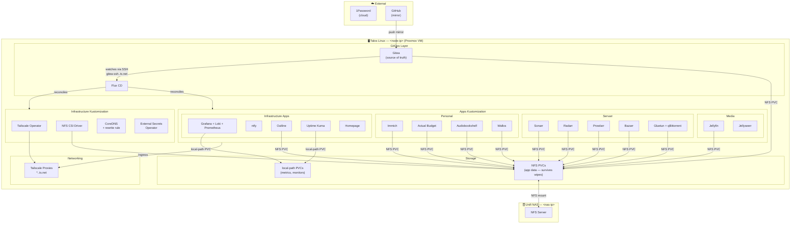
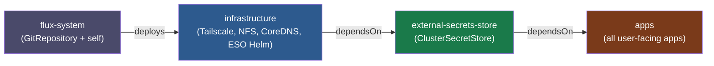
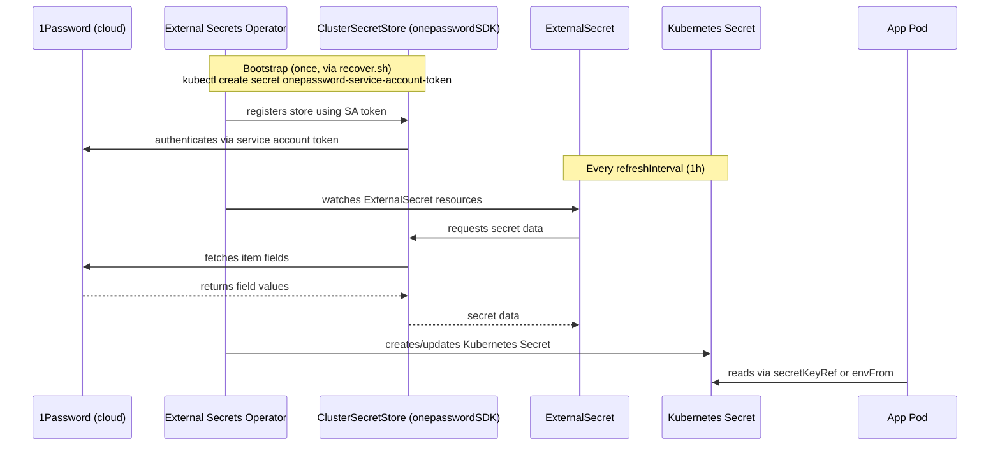

# talos-home

GitOps config for a single-node [Talos Linux](https://talos.dev) cluster running on Proxmox. Managed with [FluxCD](https://fluxcd.io).

## Stack

| Layer | Tools |
|---|---|
| OS | Talos Linux |
| Hypervisor | Proxmox |
| GitOps | FluxCD + Gitea |
| Ingress | Tailscale Operator |
| Storage | local-path (node) · NFS (Unifi NAS) |

## Apps

| App | Purpose |
|---|---|
| [Jellyfin](https://jellyfin.org) | Media server |
| [Jellyseerr](https://github.com/Fallenbagel/jellyseerr) | Media requests |
| [Sonarr](https://sonarr.tv) | TV show management |
| [Radarr](https://radarr.video) | Movie management |
| [Prowlarr](https://github.com/Prowlarr/Prowlarr) | Indexer manager |
| [Bazarr](https://www.bazarr.media) | Subtitles |
| [qBittorrent](https://qbittorrent.org) | Torrent client (via Gluetun VPN) |
| [Immich](https://immich.app) | Photo library |
| [Audiobookshelf](https://audiobookshelf.org) | Audiobooks & podcasts |
| [Actual Budget](https://actualbudget.org) | Personal finance |
| [Wallos](https://wallosapp.com) | Subscription tracker |
| [AdventureLog](https://adventurelog.app) | Travel tracker |
| [Homebox](https://homebox.software) | Home inventory |
| [IT Tools](https://it-tools.tech) | Developer utilities |
| [BentoPDF](https://bentopdf.com) | PDF toolkit |
| [Homepage](https://gethomepage.dev) | Dashboard |
| [Gitea](https://gitea.io) | Git repositories |
| [WatchYourLAN](https://github.com/aceberg/WatchYourLAN) | Network monitor |
| [LibreSpeed](https://librespeed.org) | Speed test |
| [Outline](https://www.getoutline.com) | Wiki & docs |
| [Uptime Kuma](https://uptime.kuma.pet) | Uptime monitoring |
| [Ntfy](https://ntfy.sh) | Push notifications |
| Grafana + Loki + Prometheus | Metrics & logs |

## Architecture

### Cluster overview


> **Edge colours:** 🔵 blue = GitOps / networking · 🟢 green = Flux reconcile · 🟣 purple = secrets · 🟡 yellow = NFS storage · 🔴 red = local-path storage

<details>
<summary>Mermaid source (text version)</summary>



</details>

### Flux reconciliation order



### Secret management



## Repo structure

```
provision          # the CLI entrypoint — ./provision --help
provision.toml     # ALL configuration — cluster, network, nodes, which apps run
terraform/         # provisions the Proxmox VM, Talos, Tailscale, UniFi reservation
  templates/       # Talos config patches, rendered from provision.toml
  secrets.tf       # reads credentials from 1Password at plan time
cli/               # implementation of ./provision (Python + click)
kubernetes/
  apps/            # user-facing applications (kustomization.yaml is generated)
  infrastructure/  # cluster-level components (Tailscale operator, NFS CSI, ESO)
  flux/            # FluxCD bootstrap (GitRepository + Kustomizations)
scripts/
  recover.sh       # bare-machine bootstrap: install tools, clone repo, hand off
  deploy-gitea.sh  # Gitea helm deploy (not a Flux HelmRelease — see the script)
docs/
  draw_arch.py     # generates architecture.png (requires pip install -r docs/requirements.txt)
  architecture.png # rendered diagram
```

## Provisioning

Terraform builds the node; Flux fills it. See [terraform/README.md](terraform/README.md)
and [cli/README.md](cli/README.md).

```bash
./provision up      # a machine from scratch, end to end
./provision check   # is anything pending?
```

`./provision` at the repo root is the only entrypoint. It creates a `.venv`
inside the repo on first run, so nothing is installed into your global Python
and the command cannot leak into other projects.

Terraform stops at a healthy, empty cluster. It does **not** manage NAS NFS
exports — no UniFi API exposes UNAS shares, so those stay a one-time manual
step in the UNAS UI and are consumed by the `nfs-csi` StorageClasses.

[provision.toml](provision.toml) is the single source of truth for everything
non-secret: cluster, network, nodes and which apps run. `terraform.tfvars.json`
and `kubernetes/apps/kustomization.yaml` are generated from it.

**No credential appears anywhere in this repo.** Terraform reads them from
1Password itself via the `onepassword` provider; ESO does the same in-cluster.
Authenticate with `OP_SERVICE_ACCOUNT_TOKEN` or `OP_ACCOUNT`, then
`provision secrets check`.

> Terraform state still contains the cluster CA private key, the bootstrap
> tokens and the secretbox encryption key — `talos_machine_secrets` generates
> them, so they cannot come from 1Password. State is gitignored; back it up
> with `provision state backup` after every apply.

## Turning apps on and off

[provision.toml](provision.toml) decides which apps Flux deploys.

```bash
./provision apps protect              # once, before the first disable
./provision apps disable adventurelog
git commit -am "disable adventurelog" && git push
```

Flux prunes the workloads and the memory comes back. Namespaces, PVCs and PVs
are annotated prune-exempt, so data survives and `provision apps enable` reattaches
the same volumes.

> Flux reads that annotation from the object **in the cluster**, not from git,
> so it has to be applied before an app leaves the source. `provision apps disable`
> refuses to run until it can verify this.

## Recovery

Recovering a wiped node is the same operation as provisioning a new one.

### Prerequisites
- NAS online — all NFS-backed app data lives there
- 1Password unlocked (`OP_ACCOUNT` or `OP_SERVICE_ACCOUNT_TOKEN`)
- Proxmox reachable

### On a machine that already has the repo

```bash
./provision up
```

### On a bare machine

`scripts/recover.sh` installs the tooling and clones the repo, then hands off
to the CLI. It is fetched from the **GitHub mirror**, not Gitea — Gitea runs on
the cluster being recovered.

```bash
bash <(curl -s https://raw.githubusercontent.com/d-goncalves/talos-home/master/scripts/recover.sh)
```

Then:

```bash
cd ~/talos
$EDITOR provision.toml            # fill in the <placeholder> values
export OP_ACCOUNT=my.1password.com
./provision up
```

`./provision up` runs preflight, checks the 1Password entries, regenerates the
generated files, provisions the VM and Talos, writes `~/.kube/config` and
`~/.talos/config`, seeds the two cluster secrets, hands off to Flux, and backs
up Terraform state. Every step is idempotent, so re-run it after fixing
whatever stopped it.

> **Bootstrap ordering.** Flux sources its `GitRepository` from Gitea over SSH,
> and Gitea runs on this cluster. On a cold cluster Flux cannot sync until the
> Tailscale operator and Gitea are up. It retries every minute, so this
> resolves itself — deploy Gitea with `./provision bootstrap gitea` if you want
> to hurry it along.

### What survives a full node wipe

| Storage | Apps | Survives? |
|---|---|---|
| NFS (Unifi NAS) | Jellyfin, Immich, Sonarr, Radarr, Prowlarr, Bazarr, qBittorrent, Audiobookshelf, Actual Budget, Wallos, Homebox, AdventureLog, Gitea, Outline | ✅ |
| local-path (node disk) | Uptime Kuma monitors, Prometheus metrics, Grafana dashboards | ❌ |

### Post-recovery manual steps

- **Uptime Kuma** — monitors need re-adding in the UI
- **Outline**, **Ntfy**, **Servarr** — restore automatically ✅

### Secrets management

All app secrets are managed by [External Secrets Operator](https://external-secrets.io) and pulled from 1Password automatically. No secrets are stored in git.

The following items must exist in the **Server Infrastructure** 1Password vault:

| 1Password item | Used by |
|---|---|
| `1Password Service Account - talos-home` | ESO → 1Password auth (field: `token`) |
| `Tailscale Auth Key - talos-home` | Talos Tailscale extension (field: `authkey`) |
| `servarr` | WireGuard key, qBittorrent password, Sonarr/Radarr/Prowlarr API keys |
| `AdventureLog - talos-home` | Django admin password, email, secret key, postgres password |
| `Immich - talos-home` | Postgres password |
| `Outline - talos-home` | Secret key, utils secret, postgres password, OIDC client credentials |
| `Grafana - talos-home` | Grafana admin password |

To rotate the ESO service account token, generate a new one at [1password.com](https://1password.com) → Integrations → Service Accounts, update the 1Password item, then re-run:

```bash
kubectl create secret generic onepassword-service-account-token \
  --from-literal=token=<new-token> \
  --namespace external-secrets \
  --dry-run=client -o yaml | kubectl apply -f -
```

