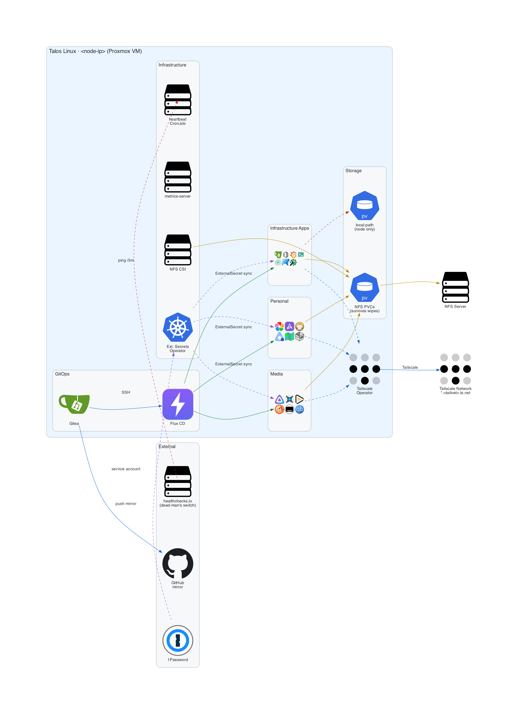

# talos-home

GitOps config for a single-node [Talos Linux](https://talos.dev) cluster running on Proxmox. Managed with [FluxCD](https://fluxcd.io).

## Stack

| Layer | Tools |
|---|---|
| OS | Talos Linux |
| Hypervisor | Proxmox |
| GitOps | FluxCD + Gitea |
| Ingress | Tailscale Operator |
| Storage | NFS (Unifi NAS) — everything durable · local-path only for disposable caches |

## Apps

| App | Purpose |
|---|---|
| [Jellyfin](https://jellyfin.org) | Media server |
| [Jellyseerr](https://github.com/Fallenbagel/jellyseerr) | Media requests |
| [Sonarr](https://sonarr.tv) | TV show management |
| [Radarr](https://radarr.video) | Movie management |
| [Prowlarr](https://github.com/Prowlarr/Prowlarr) | Indexer manager |
| [Bazarr](https://www.bazarr.media) | Subtitles |
| [qBittorrent](https://qbittorrent.org) | Torrent client (via Gluetun VPN) |
| [Immich](https://immich.app) | Photo library |
| [Audiobookshelf](https://audiobookshelf.org) | Audiobooks & podcasts |
| [Actual Budget](https://actualbudget.org) | Personal finance |
| [Wallos](https://wallosapp.com) | Subscription tracker |
| [AdventureLog](https://adventurelog.app) | Travel tracker |
| [Homebox](https://homebox.software) | Home inventory |
| [IT Tools](https://it-tools.tech) | Developer utilities |
| [BentoPDF](https://bentopdf.com) | PDF toolkit |
| [Homepage](https://gethomepage.dev) | Dashboard |
| [Gitea](https://gitea.io) | Git repositories |
| [WatchYourLAN](https://github.com/aceberg/WatchYourLAN) | Network monitor |
| [LibreSpeed](https://librespeed.org) | Speed test |
| [Outline](https://www.getoutline.com) | Wiki & docs |
| [Uptime Kuma](https://uptime.kuma.pet) | Uptime monitoring |
| [Ntfy](https://ntfy.sh) | Push notifications |
| Grafana + Loki + Prometheus | Metrics & logs — **disabled**, see `[apps]` in provision.toml |

## Architecture

### Cluster overview



> **Edge colours:** 🔵 blue = GitOps / networking · 🟢 green = Flux reconcile · 🟣 purple = secrets · 🟡 yellow = NFS storage · 🔴 red = local-path storage


### Flux reconciliation order

`flux-system` → `infrastructure` → `external-secrets-store` → `apps`, each
waiting on the last via `dependsOn`.

### Secrets

Nothing secret is committed. Terraform reads 1Password directly at plan time;
in-cluster, External Secrets syncs the same vault into Kubernetes Secrets every
hour. See [docs/rotate.md](docs/rotate.md).

## Repo structure

```
provision          # the CLI entrypoint — ./provision --help
provision.toml     # ALL configuration — cluster, network, nodes, apps, sandbox
homelab/           # the Kubernetes cluster
  terraform/       # Proxmox VM, Talos, Tailscale, UniFi reservation, healthchecks
  kubernetes/      # Flux: apps/, infrastructure/, flux/
  machine-config/  # generated Talos configs (gitignored)
  patches/         # machine config patches
  scripts/         # recover.sh (bare-machine bootstrap), deploy-gitea.sh
  docs/            # inventory, upgrade procedures
sandbox/           # a throwaway Ubuntu VM — no state, driven by the Proxmox API
pihole/            # DNS for the tailnet
  terraform/       # the tailnet nameserver list — its own state
  ansible/         # unbound, upstreams, local DNS, blocklists, admin password
cli/               # implementation of ./provision (Python + click)
docs/              # what spans all three
  rotate.md        # how to rotate every secret, and what needs re-applying
  proxmox.md       # preparing a host: API token, storage, SSH
  draw_arch.py     # generates architecture.png (pip install -r docs/requirements.txt)
  architecture.png # rendered diagram
```

## Three stacks

`./provision` manages three things that share a Proxmox host and nothing else.
One command group each, named after the directory that holds it:

| | `provision homelab` | `provision sandbox` | `provision pihole` |
|---|---|---|---|
| directory | `homelab/` | `sandbox/` | `pihole/` |
| what | the Talos cluster and its apps | a throwaway Ubuntu VM | DNS for the tailnet |
| driven by | Terraform + Flux | the Proxmox API, directly | Ansible |
| state | `terraform.tfstate`, backed up to 1Password | none | its own `terraform.tfstate`, disposable |
| lifetime | months | minutes | years |

The sandbox holds no Terraform state, so a mistake there cannot plan a change
against the cluster. Pi-hole's container is deliberately not Terraform-managed
either — see [pihole/README.md](pihole/README.md) — so `provision pihole`
reports drift rather than correcting it.

Each stack that needs Terraform has its own root and its own state, so a plan
aimed at one cannot touch the other. Only the cluster's state is irreplaceable —
it holds the cluster PKI, and `provision homelab state backup` puts it in
1Password. Pi-hole's holds a nameserver list and can be rebuilt by re-applying.

## Provisioning

Terraform builds the node; Flux fills it.

```bash
./provision homelab up      # a machine from scratch, end to end
./provision homelab check   # is anything pending?
```

`./provision` creates its own `.venv` on first run, so nothing installs
globally. [provision.toml](provision.toml) is the single source of truth for
everything non-secret; `terraform.tfvars.json` and
`homelab/kubernetes/apps/kustomization.yaml` are generated from it.

NAS exports are not managed here — no UniFi API exposes UNAS shares, so those
stay a one-time manual step and are consumed by the `nfs-csi` StorageClasses.

> Terraform state holds the cluster CA key, bootstrap tokens and the secretbox
> key: `talos_machine_secrets` generates them, so they cannot come from
> 1Password. State is gitignored — back it up with
> `./provision homelab state backup` after every apply.

See [homelab/terraform/README.md](homelab/terraform/README.md) and [cli/README.md](cli/README.md).

## Turning apps on and off

[provision.toml](provision.toml) decides which apps Flux deploys.

```bash
./provision homelab apps protect              # once, before the first disable
./provision homelab apps disable adventurelog
git commit -am "disable adventurelog" && git push
```

Namespaces, PVCs and PVs are annotated prune-exempt, so data survives and
enabling reattaches the same volumes. Flux reads that annotation from the
cluster, not from git, so `apps protect` has to run before an app leaves the
source — `apps disable` refuses until it can verify this.

## The sandbox

A disposable Ubuntu VM for testing packages you would rather not run on a
machine you care about.

```bash
./provision sandbox template          # once — builds the golden image
./provision sandbox new               # clone and boot, ~40s
./provision sandbox payload ./stuff   # attach a directory as a read-only CD
./provision sandbox offline           # unplug the virtual cable
./provision sandbox console --serial  # the only way in once offline
./provision sandbox destroy
```

`offline` drops the NIC's carrier rather than deleting it, so `online` brings it
straight back. The payload is an ISO, so the guest cannot write to it and you
never mount an untrusted filesystem on the host.

Note that cutting the link afterwards does not undo the install — if a package
is actively malicious, the dangerous moment is `apt install`. Use
`new --offline` with a `payload` when that matters.

## Rotating secrets

Every secret lives in 1Password. Most rotations need no action at all — see
[docs/rotate.md](docs/rotate.md) for the per-secret table, including the one
trap: app admin passwords are only read when the account is first created.

## Recovery

Recovering a wiped node is the same operation as provisioning a new one.

### Prerequisites

A Proxmox host prepared as in [docs/proxmox.md](docs/proxmox.md) — API token,
storage content types, host SSH.
- NAS online — all NFS-backed app data lives there
- 1Password unlocked (`OP_ACCOUNT` or `OP_SERVICE_ACCOUNT_TOKEN`)
- Proxmox reachable

### On a machine that already has the repo

```bash
./provision homelab up
```

### On a bare machine

`homelab/scripts/recover.sh` installs the tooling and clones the repo, then hands off
to the CLI. It is fetched from the **GitHub mirror**, not Gitea — Gitea runs on
the cluster being recovered.

```bash
bash <(curl -s https://raw.githubusercontent.com/d-goncalves/talos-home/master/scripts/recover.sh)
```

Then:

```bash
cd ~/talos
$EDITOR provision.toml            # fill in the <placeholder> values
export OP_ACCOUNT=my.1password.com
./provision homelab up
```

`./provision homelab up` runs preflight, checks the 1Password entries, regenerates the
generated files, provisions the VM and Talos, writes `~/.kube/config` and
`~/.talos/config`, seeds the two cluster secrets, hands off to Flux, and backs
up Terraform state. Every step is idempotent, so re-run it after fixing
whatever stopped it.

> **Bootstrap ordering.** Flux sources its `GitRepository` from Gitea over SSH,
> and Gitea runs on this cluster. On a cold cluster Flux cannot sync until the
> Tailscale operator and Gitea are up. It retries every minute, so this
> resolves itself — deploy Gitea with `./provision homelab bootstrap gitea` if you want
> to hurry it along.

### What survives a full node wipe

Everything except Immich's valkey cache. Every PVC that holds anything worth
keeping is NFS-backed, including the servarr configs, Audiobookshelf metadata
and Uptime Kuma's database. Check with:

```bash
kubectl get pvc -A -o custom-columns=SC:.spec.storageClassName,NS:.metadata.namespace,NAME:.metadata.name
```

Verified by destroying the cluster and rebuilding it: apps came back with their
data attached and nothing needed reconfiguring.

### What a rebuild does not restore

The Gitea PR webhook (repo → Settings → Webhooks) posts to ntfy so a new PR
reaches your phone. It lives in Gitea's database, not in this repo, so a Gitea
rebuild loses it — silently, since nothing fails.

Recreate it: POST to `http://ntfy.ntfy/Down` with ntfy basic auth in the
authorization header, event `pull_request`, and ntfy templating in the query
string (`tpl=yes`, plus `title`, `message`, `click`, `priority`).
`ALLOWED_HOST_LIST` in `homelab/kubernetes/apps/gitea/values.yaml` is what permits
Gitea to call an in-cluster address at all.

Pi-hole is the second. Its container is deliberately never recreated: the
tailnet nameserver list points at its Tailscale address, so a rebuilt container
gets a new identity and every device loses DNS — including away from home. See
[pihole/README.md](pihole/README.md).

### After the NAS restarts

Mounts use `hard`, so I/O blocks rather than erroring while the NAS is away —
that protects data, but leaves processes kubelet cannot kill.

```bash
./provision homelab nas recover
```

Waits for the NAS, proves it is writable, then restarts only NFS-backed pods
(16 at present, across 9 namespaces). Cleanest of all is to avoid the situation:
scale those apps down before a planned NAS reboot.

## Deliberately not doing

Recorded so they stop being rediscovered as open questions.

| | why |
|---|---|
| Offsite database backups | Accepted risk. Immich, Outline, AdventureLog and Actual Budget exist only on the NAS. |
| Talos / Kubernetes upgrades via Renovate | A node reboot is not a dependency bump — see [homelab/docs/upgrading.md](homelab/docs/upgrading.md). |
| Second node for HA | Waiting on new hardware. One host means every reboot is a full outage. |
| Immich machine learning | ~2 GB for smart search. Waiting on new hardware. |
| Pinning the last 7 `:latest` images | Stateless — see [homelab/docs/inventory.md](homelab/docs/inventory.md). The worst a surprise upgrade does is restart them. |
